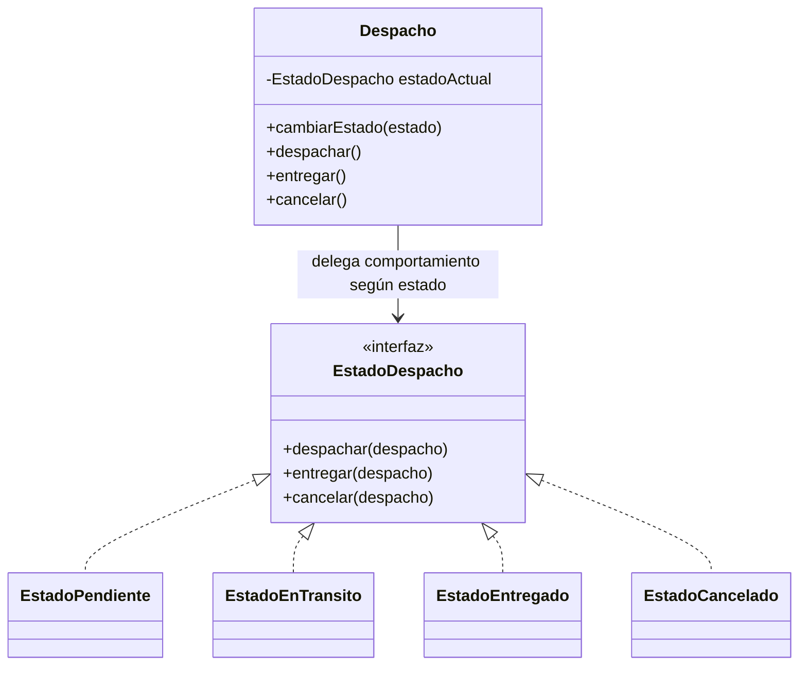
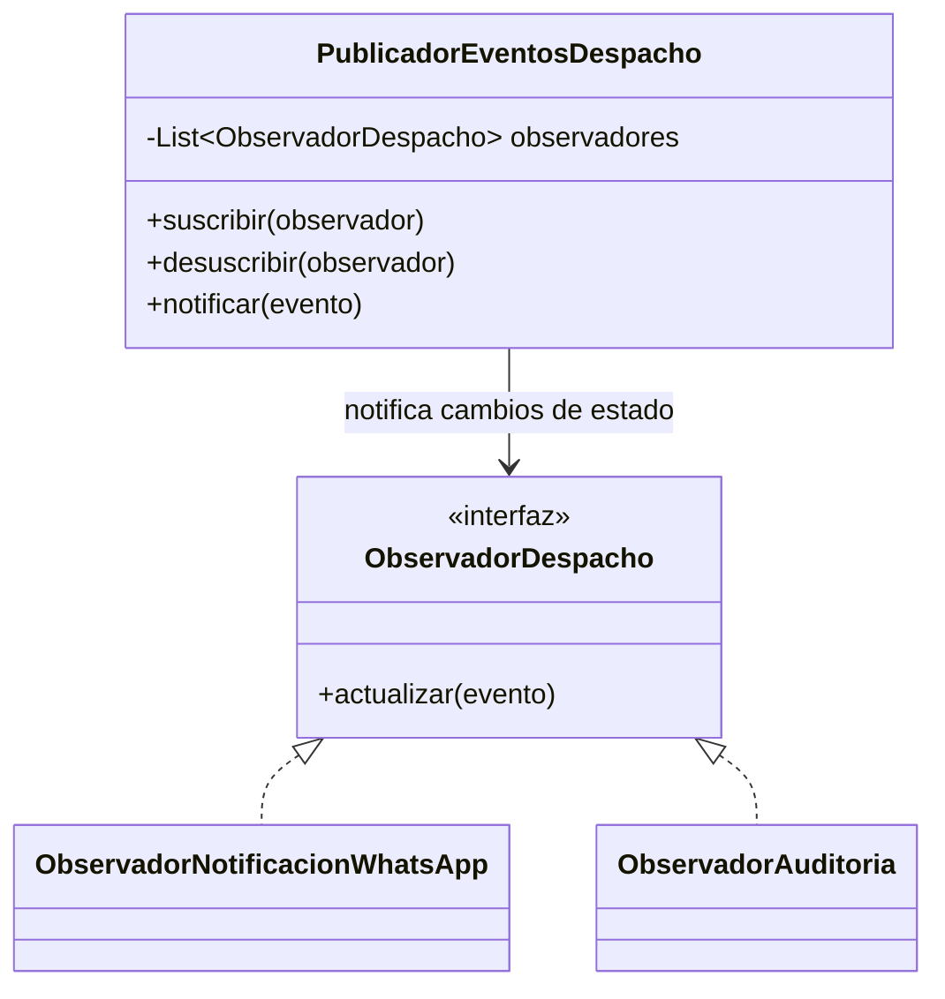
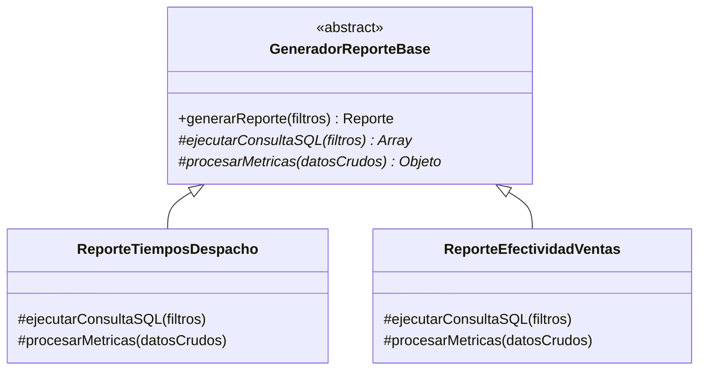
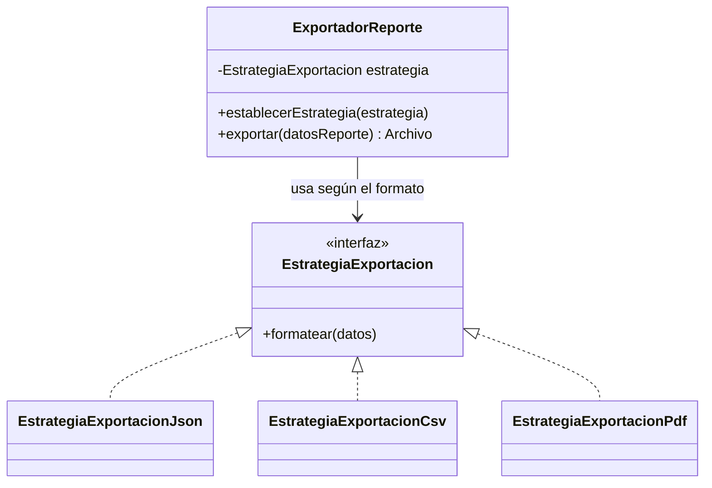

# Patrón 1 — State (Estado)

### Nombre y familia

**State**, patrón de **comportamiento**.

### Problema concreto del módulo

Un despacho en el sistema pasa por un ciclo de vida con cuatro estados clave, y cada uno impone reglas estrictas de negocio sobre qué acciones están permitidas:

| Estado | Acciones permitidas | Validación específica |
|---|---|---|
| Pendiente | Despachar, Cancelar | Debe contar con confirmación de pago y datos de envío completos |
| En Tránsito | Entregar, Reportar Incidencia | Debe tener asignado un transportista y código de seguimiento |
| Entregado | Ninguna (Estado final) | Genera el comprobante de entrega; no permite cambios ni cancelación |
| Cancelado | Ninguna (Estado final) | Libera la orden; es un estado terminal e irreversible |

Sin un patrón, las transiciones y validaciones del despacho terminarían implementadas con bloques `if/else` o `switch` dentro de la entidad principal. Esto provocaría que agregar reglas o estados (por ejemplo, "En Devolución") obligue a modificar el código existente, aumentando el riesgo de permitir transiciones inválidas (como entregar un pedido cancelado). State encapsula el comportamiento y las restricciones de cada fase en clases independientes.

### Estado

**Aplicado** (definido en el diseño de dominio e implementado en el núcleo de logística).

### Fragmento del diagrama de clases

**Flujo:**

1. La entidad `Despacho` se instancia e inicia vinculada al `EstadoPendiente`.
2. Al solicitar la acción `despachar()`, el `Despacho` delega la validación a su `estadoActual`.
3. `EstadoPendiente` verifica las precondiciones de envío y actualiza la referencia de la entidad a `EstadoEnTransito`.
4. Si se invoca una acción inválida para la fase activa (por ejemplo, `entregar()` desde `EstadoPendiente`), la clase de estado arroja una excepción de negocio sin modificar la entidad.

### Trade-offs aceptados

- **Más clases:** una interfaz y cuatro clases de estado concretas en lugar de métodos condicionales.
- **Indirección:** la lógica de cambio de estado está distribuida entre las distintas clases de estado.
- **Acoplamiento entre estados:** las clases de estado deben conocer a cuál estado transicionar a continuación.

---

# Patrón 2 — Observer (Observador)

### Nombre y familia

**Observer**, patrón de **comportamiento**.

### Problema concreto del módulo

Al cambiar el estado de un despacho, diversos componentes independientes deben reaccionar según el nuevo evento:

| Evento de Despacho | Suscriptor / Reacción | Propósito |
|---|---|---|
| Cambio a "En Tránsito" | Notificador de WhatsApp | Enviar al cliente el enlace de seguimiento del pedido |
| Cambio a "Entregado" | Módulo de Auditoría | Registrar timestamp y confirmación para métricas operativas |
| Cambio a "Cancelado" | Notificador de WhatsApp | Informar al cliente sobre el estado de la cancelación |

Sin el patrón, el servicio de despacho tendría que invocar directamente la API de WhatsApp y el sistema de auditoría dentro de la misma función. Si el servicio de mensajería falla o se retrasa, bloquearía o cancelaría la transacción de logística. Observer permite que el servicio emita el evento y que los suscriptores reaccionen de forma desacoplada y asíncrona.

### Estado

**Previsto** (se implementará en la siguiente entrega).

### Fragmento del diagrama de clases

**Flujo:**

1. Al iniciar el módulo, `ObservadorNotificacionWhatsApp` y `ObservadorAuditoria` se registran en `PublicadorEventosDespacho`.
2. Al confirmarse un cambio de estado en `Despacho`, el servicio llama a `notificar(evento)` en el publicador.
3. El publicador recorre sus observadores invocando `actualizar(evento)` de manera asíncrona.
4. Cada observador procesa su tarea de forma aislada sin afectar el tiempo de respuesta del flujo principal de despacho.

### Trade-offs aceptados

- **Complejidad en depuración:** el flujo de ejecución no es lineal, lo que requiere trazabilidad por logs para auditar las reacciones a eventos.
- **Orden de ejecución indeterminado:** los observadores se ejecutan de forma independiente y no deben depender de un orden específico.
- **Manejo de fallos en suscriptores:** si la notificación de WhatsApp falla, se requiere una cola de reintentos para no perder el mensaje.

---

# Patrón 3 — Template Method (Método Plantilla)

### Nombre y familia

**Template Method**, patrón de **comportamiento**.

### Problema concreto del módulo

El submódulo de reportes genera distintos informes analíticos sobre vistas SQL de solo lectura, pero todos comparten exactamente el mismo flujo de ejecución:

| Fase del flujo | Comportamiento común | Variación según reporte |
|---|---|---|
| 1. Conexión y Filtros | Conecta a la vista SQL de solo lectura y aplica fechas | La vista SQL consultada cambia |
| 2. Consulta | Ejecuta la query parametrizada | La estructura de la consulta SQL es única |
| 3. Procesamiento | Parsea los registros retornados | El cálculo de métricas e indicadores varía |
| 4. Consolidación | Construye la respuesta JSON estándar | El payload final adapta sus campos |

Sin un patrón, cada clase de reporte reimplementaría la apertura de conexiones, el manejo de errores y la estructura del flujo, duplicando código de infraestructura. Template Method define el esqueleto del proceso en una clase base abstracta y delega solo la consulta y el cálculo específico a las subclases.

### Estado

**Aplicado** (definido en el diseño del pipeline de consultas sobre las vistas SQL).

### Fragmento del diagrama de clases

**Flujo:**

1. El cliente invoca `generarReporte(filtros)` en la instancia del reporte solicitado.
2. El método plantilla valida los filtros y llama a `ejecutarConsultaSQL()`, ejecutando la query sobre la vista de solo lectura.
3. El método plantilla toma los datos crudos y llama a `procesarMetricas()` para calcular los indicadores.
4. Se estructura y retorna la respuesta analítica estandarizada.

### Trade-offs aceptados

- **Acoplamiento por herencia:** las clases de reportes quedan ligadas a la jerarquía de la clase base abstracta.
- **Poca flexibilidad en el flujo:** si un reporte requiere un flujo drásticamente distinto, no encaja en la plantilla.
- **Cero duplicación:** garantiza que toda consulta a las vistas SQL siga las mismas políticas de seguridad y timeout.

---

# Patrón 4 — Strategy (Estrategia)

### Nombre y familia

**Strategy**, patrón de **comportamiento**.

### Problema concreto del módulo

Los reportes analíticos procesados deben entregarse en múltiples formatos según el consumidor que los solicite:

| Formato | Consumidor | Propósito |
|---|---|---|
| JSON | Dashboard Web | Renderizar gráficos e indicadores en tiempo real |
| CSV | Exportación Masiva | Análisis de datos en planillas de cálculo (Excel) |
| PDF | Reporte Ejecutivo | Informes imprimibles para la gerencia |

Sin el patrón, la lógica para transformar los datos a cada formato estaría dentro del servicio de reportes mediante condicionales `switch(formato)`. Esto viola el principio Abierto/Cerrado (OCP), ya que agregar un nuevo formato (por ejemplo, Excel `.xlsx`) obligaría a modificar el código del generador de reportes. Strategy aísla la lógica de formateo en clases intercambiables.

### Estado

**Previsto** (se implementará en la siguiente entrega).

### Fragmento del diagrama de clases

**Flujo:**

1. El servicio recibe los datos del reporte generado y el formato de salida solicitado.
2. Se selecciona e instancian la estrategia adecuada (`EstrategiaExportacionCsv`, `EstrategiaExportacionPdf`, etc.).
3. `ExportadorReporte` ejecuta `exportar()`, delegando la transformación al método `formatear()` de la estrategia activa.
4. Se devuelve el archivo serializado listo para la descarga o consumo de la API.

### Trade-offs aceptados

- **Mayor número de clases:** requiere definir una interfaz y una clase por cada formato de exportación.
- **Configuración previa:** el cliente debe indicar o instanciar la estrategia antes de procesar el archivo.
- **Extensibilidad:** permite añadir nuevos formatos de salida sin tocar la lógica de negocio de los reportes.