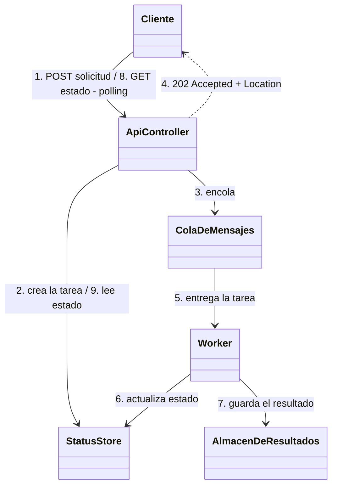
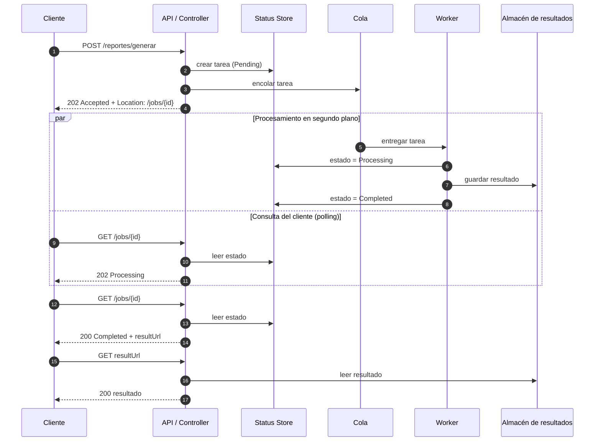

# Asynchronous Request-Reply 

## Desarrollo conceptual

### Categoría e intención

- **Categoría:** patrón de nube (Cloud Design Pattern) de comunicación asíncrona entre un cliente y un backend. Está documentado en el catálogo de patrones de nube de Azure Architecture Center, aunque es aplicable a cualquier sistema distribuido.
- **Intención:** desacoplar el procesamiento del backend de la solicitud del cliente, cuando el procesamiento debe ser asíncrono pero el cliente igualmente necesita una respuesta clara sobre el resultado.

### Problema de diseño que resuelve

Una operación tarda más de lo que una conexión HTTP puede esperar con seguridad (segundos, minutos o más). Si se resuelve dentro de la misma request:

- el cliente mantiene la conexión abierta y puede terminar en **timeout**;
- el servidor dedica un hilo o recurso a esa request durante todo el procesamiento;
- si el cliente se rinde, el trabajo no tiene a quién responder.

El patrón separa la interacción en **dos fases**: una confirmación inmediata de que la solicitud fue aceptada, y una consulta posterior del resultado.

### Motivación

**Situación típica.** En el ERP, un usuario (o un webhook de WhatsApp) pide un reporte consolidado de envíos y ventas, o el procesamiento masivo de guías de despacho. Con miles de registros, compilar documentos y consultar APIs de couriers toma varios segundos.

**Por qué las soluciones ingenuas no bastan:**

| Solución ingenua | Por qué resulta insuficiente |
|---|---|
| Procesar todo dentro de la request (síncrono) | Timeout del cliente y recursos del servidor bloqueados durante todo el trabajo. |
| Aumentar el timeout | Solo posterga el problema: el trabajo puede tardar más que cualquier límite razonable, y proxies o balanceadores imponen sus propios topes. |
| Responder "OK" y procesar sin dar más información (fire and forget) | El cliente no sabe si terminó, si falló ni dónde está el resultado. |
| Un hilo o proceso por request | No escala: la capacidad queda atada a la cantidad de solicitudes simultáneas, no a la capacidad real de procesamiento. |

### Estructura del patrón

#### Diagrama de componentes

Sí, se puede acortar. Lo que se pierde son los métodos de cada clase (lo que hace cada participante). Los componentes, las relaciones y el orden de los pasos se mantienen.



### Participantes y responsabilidades

| Participante | Responsabilidad |
|---|---|
| **Cliente** | Envía la solicitud, guarda la URL de estado y consulta periódicamente (respetando `Retry-After`) hasta que la tarea termine. |
| **API / Controller** | Valida la solicitud (si es inválida, responde de inmediato `400`), crea la tarea, la encola y responde `202 Accepted` con la cabecera `Location`. También expone el endpoint de estado. |
| **Cola de mensajes** | Almacena las tareas pendientes y desacopla el ritmo de llegada del ritmo de procesamiento. |
| **Worker** | Toma tareas de la cola, ejecuta el trabajo pesado, actualiza el progreso y registra el resultado o el error. |
| **Status Store** | Guarda el estado de cada tarea (`Pending`, `Processing`, `Completed`, `Failed`), su progreso y la referencia al resultado. |
| **Almacén de resultados** | Guarda el resultado final cuando es pesado. El estado solo contiene una referencia. |

#### Diagrama de secuencia



**Contrato entre cliente y API:**

| Paso | Respuesta |
|---|---|
| Solicitud aceptada | `202 Accepted` + `Location: /jobs/{id}` (y opcionalmente `Retry-After`) |
| Tarea en curso | `202` con el estado y, si se conoce, el progreso |
| Tarea terminada | `200` con el estado final y la URL del resultado (variante: redirección al recurso final) |
| Tarea inexistente o vencida | `404` |

---

## Consideraciones técnicas

### Aplicabilidad

**Señales de que es una buena opción:**

- La operación tarda más de unos 2 a 3 segundos o su duración es impredecible.
- Hay riesgo de timeout en el cliente, el proxy o el balanceador.
- El procesamiento depende de servicios externos lentos (por ejemplo, APIs de couriers) o consume mucha CPU (compilar PDFs masivos).
- El cliente solo puede usar HTTP y no puede exponer un endpoint para recibir notificaciones.
- Se quiere escalar el procesamiento de forma independiente de la API.

**Cuándo se puede introducir complejidad innecesaria:**

- Operaciones CRUD simples y rápidas.
- Cuando el cliente necesita el resultado de inmediato para continuar y la operación es rápida.
- Cuando el cliente puede recibir una notificación directa (webhook, evento): puede resultar más simple y eficiente que consultar de forma repetida.
- Sistemas de bajo volumen donde el costo de operar cola, worker y almacén de estado supera el beneficio.

### Consecuencias y trade-offs

| Beneficios | Costos |
|---|---|
| Respuesta inmediata al cliente y desaparecen los timeouts por trabajo largo. | más componentes que desplegar, monitorear y mantener. |
| Libera recursos de la API (no queda bloqueada por el trabajo pesado). | el resultado no está disponible al instante. |
| Escalabilidad independiente, se agregan workers sin tocar la API. | Hay que gestionar el estado de cada tarea y hacerlo duradero. |
| El cliente puede consultar el progreso. | El polling genera tráfico adicional, se mitiga con `Retry-After` o espera creciente. |
| Tolera picos de carga, la cola absorbe las solicitudes. | Necesita limpieza de tareas huérfanas y resultados vencidos. |
| Aísla fallos, un error del worker no tumba la API. | Más casos de error que tratar: tareas fallidas, reintentos, duplicados (conviene idempotencia). |


### Implementación

**Secuencia** El cliente envía la solicitud; la API responde `202 Accepted` con `Location` apuntando a un endpoint de estado y, opcionalmente, `Retry-After`. Mientras la tarea está en curso, el endpoint de estado responde con el estado actual. Al terminar, responde con el resultado o redirige al recurso final.

**Cómo se concreta en la demo y en qué difiere:**

| Aspecto | Formulación del patrón / producción | Demo |
|---|---|---|
| Cola | Broker de mensajes (BullMQ con Redis, RabbitMQ, SQS, Service Bus) | Arreglo en memoria |
| Worker | Proceso o servicio separado, o `worker_threads` | Función en el mismo proceso, por lotes, cediendo el turno con `setImmediate` |
| Status Store | Redis o PostgreSQL (duradero) | `Map` en memoria; un reinicio pierde las tareas |
| Resultado | Almacén de objetos (S3, Blob Storage) referenciado desde el estado | Se guarda con el estado |
| Estado en curso | Varía por implementación | `202` con `status` y `progress`; `200` con `resultUrl` al terminar |

**Particularidad de Node.js:** ejecuta el código JavaScript en un solo hilo con un **event loop**. Un trabajo de CPU dentro de la request bloquea todas las demás solicitudes, no solo la propia. Por eso el trabajo pesado debe salir del hilo de la API: a otro proceso, a `worker_threads` o a una cola con workers dedicados. En la demo el worker comparte el proceso y solo evita el bloqueo prolongado porque procesa por lotes; esto sirve para explicar el patrón, no como diseño de producción.

**Equivalentes en la nube:** una función HTTP que recibe la solicitud, una cola administrada (Storage Queue, Service Bus, SQS), una función o contenedor como worker y una tabla o base de datos para el estado.

### Patrones relacionados

| Patrón | Relación | Cómo decidir |
|---|---|---|
| **Claim-Check** | Se combina | Si el resultado o la carga es grande, se guarda en un almacén y solo viaja una referencia. Aplica al reporte descargable. |
| **Queue-Based Load Leveling** | Se combina | Es la cola que absorbe los picos entre la API y los workers. Úsalo cuando la carga de solicitudes sea irregular. |
| **Competing Consumers** | Se combina | Varios workers leen de la misma cola para aumentar el rendimiento. Úsalo al necesitar más capacidad de procesamiento. |
| **Priority Queue** | Se combina | Si ciertas solicitudes deben procesarse antes (por ejemplo, reportes urgentes). |
| **Webhooks / Publisher-Subscriber** | Compite | Con webhooks el servidor *empuja* el resultado al terminar; con este patrón el cliente *consulta*. Prefiere webhooks o eventos si el cliente puede recibir notificaciones y quieres evitar el *polling*. Prefiere este patrón si el cliente solo puede usar HTTP simple o no es accesible desde el servidor. |

**Regla práctica:** si el cliente no puede ser notificado y la operación es larga, usa Asynchronous Request-Reply. Si el cliente puede recibir notificaciones, evalúa webhooks o eventos. Si la operación es rápida, mantén la llamada síncrona.

## 3. Demo

## Escenario

El ERP de ventas por WhatsApp tiene un módulo de despachos y reportes. En él, un usuario (o un webhook de WhatsApp) puede pedir el Reporte Logístico de Despachos: un consolidado de los envíos de un periodo, con sus estados, couriers y montos. Con miles de despachos, generarlo implica mucho procesamiento, como armar documentos, calcular totales y consultar servicios de couriers. En la demo ese trabajo se simula como 30 lotes de 100 ms de CPU cada uno, es decir, unos 3 segundos.

## Herramientas
- **Node.js (>= 20.6):** ejecuta el servidor (un solo hilo: un trabajo pesado síncrono bloquea a todos).
- **TypeScript:** código con tipos.
- **Express:** define los endpoints y los códigos `202` / `200`.
- **tsx:** corre los `.ts` sin compilar.
- **fetch (nativo de Node):** lo usa `demo.ts` para llamar a la API.

## Archivos
| Archivo | Contenido |
|---|---|
| `antes.ts` | Endpoint síncrono: bloquea el servidor y el cliente termina en timeout. |
| `despues.ts` | El patrón completo, con cada participante comentado. |
| `demo.ts` | Ejecuta ANTES y DESPUÉS y muestra el resultado en consola. |

## Mapeo de participantes (en `despues.ts`)
| Participante del patrón | En el código |
|---|---|
| Controller | rutas `POST /reportes/generar`, `GET /jobs/:id`, `GET /reportes/:id/resultado` |
| Queue | arreglo `cola` |
| Worker | función `worker()` (procesa por lotes y cede el turno con `setImmediate`) |
| Status Store | `Map` `statusStore` |

## Flujo
1. `POST /reportes/generar` -> `202 Accepted` + `Location: /jobs/{id}` (al instante).
2. `GET /jobs/{id}` -> `202` con `Pending` o `Processing` y el progreso (polling).
3. `GET /jobs/{id}` -> `200` con `Completed` y `resultUrl`.
4. `GET {resultUrl}` -> el resultado.

## Antes / Después
| | ANTES | DESPUÉS |
|---|---|---|
| Respuesta | Al terminar el trabajo (~3 s) | `202` en milisegundos |
| Servidor | Bloqueado: `/health` espera todo el trabajo | Libre: `/health` responde |
| Cliente | Timeout si tarda más que su límite | Consulta el estado cuando quiere |

## Pasos a seguir
1. `npm install`
2. `npm run demo` (~10 s): levanta ambos servidores y muestra el antes y el después.

Para probar a mano: `npm run antes` (puerto 3001) o `npm run despues` (puerto 3002).

## Salida real de `npm run demo`

```text
=== ANTES: POST /reportes/generar (síncrono) ===
POST /reportes/generar -> ERROR: timeout tras 2006 ms (el cliente se rindió)
GET  /health           -> respondió recién tras 2802 ms (servidor bloqueado)

=== DESPUÉS: Asynchronous Request-Reply ===
POST /reportes/generar -> 202 Accepted en 3 ms
Location: /jobs/cf335377-9ffe-4f63-bdf8-efee8ca3869d

Consulta 1: GET /jobs/cf335377... -> 202 {"status":"Processing","progress":3}  | /health: 99 ms
Consulta 2: GET /jobs/cf335377... -> 202 {"status":"Processing","progress":50}  | /health: 100 ms
Consulta 3: GET /jobs/cf335377... -> 202 {"status":"Processing","progress":97}  | /health: 100 ms
Consulta 4: GET /jobs/cf335377... -> 200 {"status":"Completed","resultUrl":"/reportes/cf335377-9ffe-4f63-bdf8-efee8ca3869d/resultado"}  | /health: 1 ms
GET /reportes/cf335377-9... -> 200 {"resultado":"Reporte de despachos generado"}
```

## Límites de la demo
- Cola y Status Store en memoria: un reinicio pierde los jobs. En producción serían Redis/BullMQ o PostgreSQL.
- El costo de CPU es simulado (`procesarLote`).

---